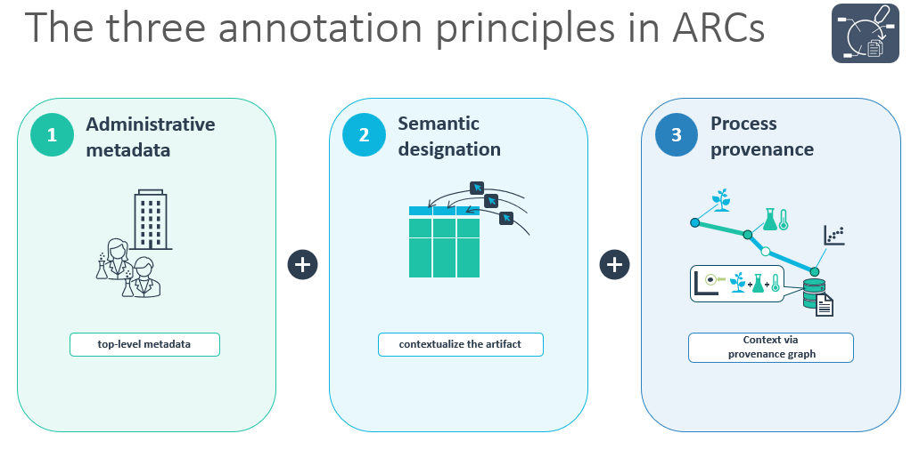
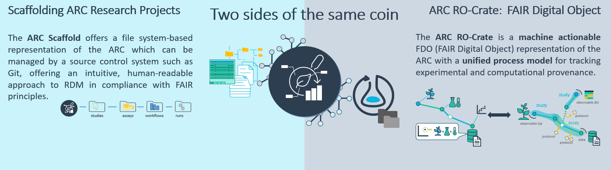

# [Discussion/RFC] Split specification into core ARC concepts and DataPLANTs reference implementations

## Motivation

The ARC in how DataPLANT supports it and develops tooling for is a historically grown fusion of core concepts and plant research-specific or -adjacent usage of standards and/or perspectives. However, the ARC concept itself is in no way domain specific for plant research - but might look like it from the outside due to the usage of e.g. ISA.

The general direction of the work we are doing on ARCs and related infrastructure and tooling gives a clear picture: we built a system with specific implementations for solid foundational concepts. Now the push is to distill the core concepts from the implementation details, ensuring that the ARC framework remains flexible and adaptable to various research domains.

in this Discussion/RFC, i want to lay out the foundations and plan on how to decouple the core ARC specification from DataPLANT's domain-specific implementations of these concepts. That way, we can prevent the ARC from being seen as a domain-specific FDO (which it is not!), while defining the guard rails for implementing ARC-based systems in other domains of research.

Some examples on why this is necessary:

- **The current ARC specification defines an ARC as a strict folder structure in which MANDATORY ISA and CWL-formatted metadata files reside**

  While in its core completely in line with the ARC's core process-centric view on RDM, ISA is percieved as an experimental biologists standard. Furthermore, the usage of ISA-XLSX for initially reducing usage barriers has been discussed many times and does not need to be repeated here.

  The ARC as a concept has evolved in a way that this is only one realization of an ARC. Other systems should be able to use all of our initial choices, some, or even none. I will explain this further in the [ARC Workspace section]().

- **The current specification conflates concepts with DataPLANT's infrastructure-specific decisions**

  Case in point: [Continuous Quality Control](https://github.com/nfdi4plants/ARC-specification/blob/release/ARC%20specification.md#continuous-quality-control). Here, DataPLANT's specific infrastructure choices - for example tracking validation provenance in a git branch with a specific name or how to configure what validation package should be run on the ARC DataHUB - lies on the same level as core ARC concept descriptions. This is not only unecessary (people should be able to implement this in their own systems according to their needs) but also makes iterating on these implementations slower since they are coupled to actual releases of the FULL specification.

## Proposed Approach

The proposed approach is to clearly separate the core ARC concepts from DataPLANT's reference implementations. 

I identified the following key areas where the separation should be applied:

- [The ARC Base Model](#the-arc-base-model)
- [ARC Workspaces](#arc-workspaces)
- [Embedding ARCs into (cloud?) infrastructure](#embedding-arcs-into-infrastructure)
  - [ARC Validation](#arc-validation)
  - [Continuous Quality Control](#continuous-quality-control)
- [ARC Publication Space and RO-crate as the core harmonization layer](#publication-space-and-ro-crate-as-the-core-harmonization-layer) 

### The ARC Base Model

#### Administrative Metadata

#### Semantic Designation

(cite and reference below: https://www.degruyterbrill.com/de/document/doi/10.1515/jib-2025-0052/html)

#### Process Provenance

### ARC Workspaces

An ARC workspace is the materialization of an ARC on disk intended for active use and development by researchers and other stakeholders involved in the research data management process.

The current specification defines an ARC workspace as a strict folder structure with mandatory ISA-formatted metadata files.

In a push for connecting the ARC to the wider RDM landscape, we invested significant resources into developing the RO-Crate representation of the ARC.

The distillation of the [ARC Base Model](#the-arc-base-model) was only possible due to the development of the ARC RO-Crate profiles since this forced us to evaluate the core concepts and requirements without the support of the previously chosen standards in the workspace. (cite and reference below: https://osf.io/preprints/biohackrxiv/7y2jh_v1 , https://www.degruyterbrill.com/de/document/doi/10.1515/jib-2025-0050/html)

This led to the first conceptual evolution of the ARC: **two sides of the same coin**. For each state of the ISA/CWL workspace, we were now able to attach the a RO-Crate representation, capturing the same information in a more flexible and interoperable format. Note that in this iteration, the ARC worspace was called the _ARC Scaffold_

Opening up the ARC workspace as a concept with different implementations and standards used is the logical next step. **If the workspace should actually be compatible with an implementation of (and how many of) the ARC Base Model concepts is a question that needs to be addressed and discussed.**

### Embedding ARCs into infrastructure

#### DataHUB

- slight problem of PLANTdataHUB being the core paper that is usually referenced to cite that someone worked with our infrastructure (cite and reference below: https://onlinelibrary.wiley.com/doi/full/10.1111/tpj.16474)

- the choice of gitlab was right, we can implement a lot based on it

- however, other future ARC implementations might not even be git repos

- a spec rework should reflect these as OUR impementation choices, ARCs in other systems might not even be git repos as long as they can track states in some provenance framework

#### ARC Validation

- Conceptual AND specific spec is combined here, i proipose a simple split

cite and reference below:   
https://osf.io/preprints/biohackrxiv/zah28
https://onlinelibrary.wiley.com/doi/full/10.1111/tpj.16474

#### Continuous Quality Control

- Conceptual AND specific spec is combined here, i proipose a simple split

### Publication Space and RO-crate as the core harmonization layer

Publication space is just consequently generalizing two sides of the same coin in the ro crate dimension. We identified RO-Crate as the FDO harmonization layer. 

**An ARC could therefore be defined as anything that applies (one? two? all?) ARC Base Model concepts (with or without decorations) in any domain-specific workspace and can be expressed as an RO Crate based on (one? two? all?) of the ARC RO-Crate profiles.** This is basically the central "new" and generalized ARC definition and should be extensively discussed.

cite and reference below: https://link.springer.com/article/10.1007/s42979-026-05010-8

## Implementation checklist

- [ ] Define the ARC Workspace conceptually in the core spec, and move everything ISA(XLSX) and CWL related into the implementation-specific section.
- [ ]
- [ ]
- [ ]
- [ ]
- [ ]

## References

- [1]: Bla
- [2]: Another reference
- [3]: Yet another reference
- [4]: Yet another reference
- [5]: Yet another reference